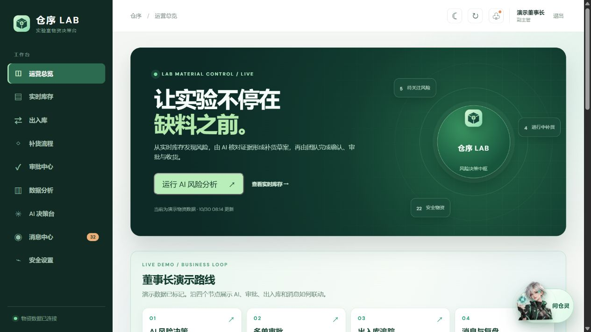
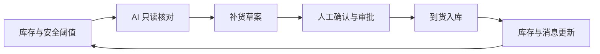
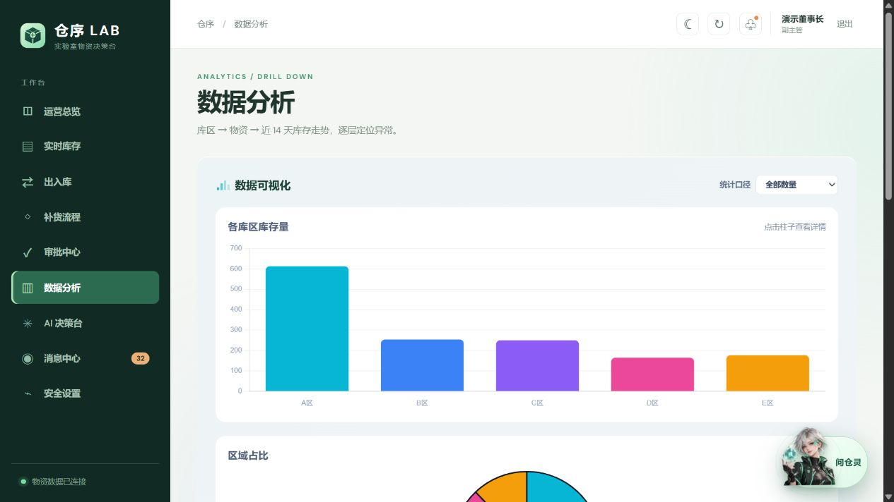
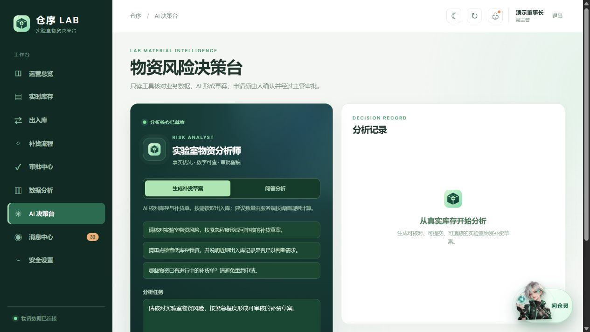
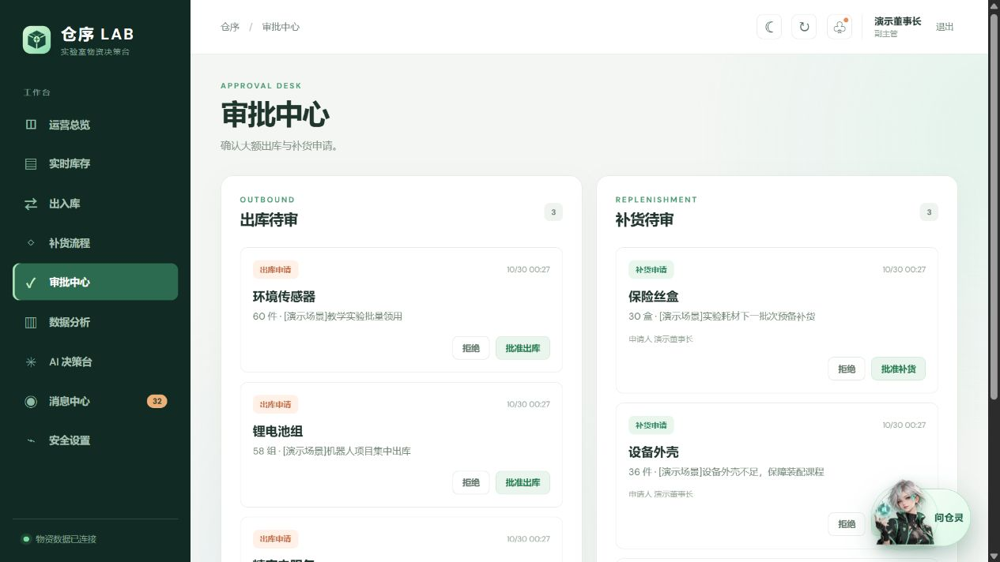

<p align="center"></p>

<h1 align="center">仓序 LAB</h1>

<p align="center">AI 驱动的实验室物资风险与补货决策系统</p>
<p align="center">Vue 3 · Express · MySQL · DeepSeek</p>



仓序 LAB 面向实验室和创客空间：用实时库存发现缺口，让 AI 核对证据并生成补货草案，再由人确认、审批和收货。每一步都与库存、操作记录及消息联动。当前仓库包含可复现的演示数据，适用于功能展示与赛事答辩。

## 业务闭环



| 能力 | 可以做什么 |
| --- | --- |
| AI 风险决策 | 读取实时库存、出入库和补货状态，形成可追溯草案；AI 不直接修改库存。 |
| 库存与出入库 | 查看预警和趋势，登记出入库，建立新物资；大额出库进入审批。 |
| 补货与审批 | 申请、批准或驳回、确认到货，记录完整流转过程。 |
| 数据分析 | 按库区、物资逐层钻取，查看数量占比和近 14 天库存走势。 |
| 消息中心 | 分类查看审批、补货和库存提醒，支持一键已读与 AI 简报。 |
| 账号与权限 | 董事长、主管、副主管、仓管员、观察员分工；登录和接口均实施权限检查。 |

## 界面预览

| 数据分析 | AI 决策台 |
| --- | --- |
|  |  |



[查看完整数据分析页面](docs/screenshots/analytics.png) · [阅读技术文档](技术文档.pdf)

## 技术结构

```text
浏览器（Vue 3 / Vue Router / Chart.js）
                │  /api
                ▼
       Express API ────────→ DeepSeek
                │             仅服务端调用
                ▼
              MySQL
       库存、业务记录、AI 草案、会话
```

AI 使用服务端只读工具核对业务数据，建议数量按库存与安全阈值计算。提交草案时会再次校验库存、重复申请和有效期；审批与收货由有权限的用户完成。浏览器不会接收模型密钥。

## 本地运行

需要 **Node.js 20+** 与 **MySQL 8**。

1. 在 MySQL 客户端执行 [`server/schema.sql`](server/schema.sql)，创建数据库与初始演示物资。已有旧版数据库先阅读下方升级说明。
2. 安装依赖并创建本地配置文件：

   ```powershell
   npm install
   Copy-Item server/.env.example server/.env
   ```

3. 编辑 `server/.env`，至少配置 `DB_USER`、`DB_PASSWORD`、`BOOTSTRAP_MANAGER_PASSWORD` 和 `AI_API_KEY`。MySQL 应用账号的授权示例见 `server/schema.sql` 末尾。
4. 启动前后端并打开 <http://127.0.0.1:5173/>：

   ```powershell
   npm run dev
   ```

首次启动且用户表为空时会创建主管账号 `admin`，密码为配置的 `BOOTSTRAP_MANAGER_PASSWORD`。服务端默认监听 `127.0.0.1:3001`，`/api/health` 可检查数据库和 AI 配置状态。

### `server/.env` 是什么？

它是**只保存在本机的环境变量配置文件**，用于存放数据库密码、首次登录密码和 DeepSeek API 密钥。仓库提交的是不含真实密钥的 [`server/.env.example`](server/.env.example) 模板；`.gitignore` 会排除 `server/.env`。部署时也可以在部署平台设置同名环境变量。不要把真实值写进 README、前端 `VITE_` 变量、截图或 Git 提交。

忘记密码时，主管可重置下属账号，董事长可重置主管及其他岗位账号。管理账号无法登录时，由数据库管理员在私有环境变量中设置 `DB_ADMIN_USER`、`DB_ADMIN_PASSWORD`、`RECOVERY_USERNAME`、`RECOVERY_NEW_PASSWORD`，再运行 `npm run account:recover -w server`。恢复会撤销该账号原有会话。

### 已有数据库与演示数据

- 旧版库：配置私有的 `DB_ADMIN_USER`、`DB_ADMIN_PASSWORD` 后运行 `npm run db:migrate -w server`；重复执行 `schema.sql` 不会升级既有表。
- 增加演示物资：`npm run db:seed -w server`；生成库存走势样本：`npm run db:seed-trend -w server`。两者均支持重复运行。
- 准备答辩场景：先运行数据库迁移，在私有配置中设置 `DEMO_CHAIRMAN_PASSWORD`（12—128 位），再运行 `npm run db:seed-demo -w server`。将创建或升级独立的 `chairman_demo` 董事长演示账号，并准备待审批、消息、低库存场景；不会覆盖已有密码。

## 验证与资料

```powershell
npm run build
npm run test:unit -w server
```

服务启动后还可运行 `node server/scripts/smoke.mjs` 进行业务联动验证。完整设计、权限、安全和测试说明见 [技术文档](技术文档.pdf)。演示视频由参赛者另行录制。
